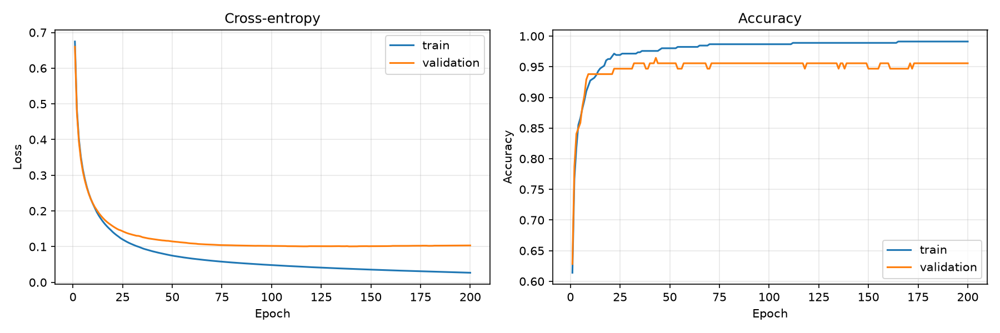

# Многослойный персептрон

Сеть предсказывает доброкачественный (`B`) или злокачественный (`M`) диагноз по 30 числовым признакам. Для вычислений используется NumPy, для графиков обучения — Matplotlib

## Отчёт о проекте

Набор данных содержит 569 объектов: 357 доброкачественных и 212 злокачественных случаев. В исходной строке также указаны идентификатор объекта и диагноз

Программа создаёт воспроизводимые стратифицированные обучающую и проверочную выборки. Она стандартизирует признаки по статистикам обучающей выборки, обучает сеть обратным распространением ошибки и градиентным спуском по мини-пакетам, а также выводит loss и accuracy для обеих выборок

Выходной слой применяет softmax. Файл модели содержит структуру сети, веса, смещения, метки классов и параметры масштабирования признаков. Прогнозирование вычисляет бинарную кросс-энтропию и accuracy, затем записывает вероятности классов в CSV-файл

### Кривые обучения

На графиках показан один запуск на фиксированном стратифицированном разбиении с seed `42`



В запуске использованы 30 входных признаков, два скрытых слоя по 24 нейрона и два выходных класса. Сеть содержит 1 394 обучаемых параметра. После 200 эпох loss и accuracy на обучающей выборке составили 0.0269 и 0.9912, на проверочной — 0.1034 и 0.9558

Эти результаты относятся к одному разбиению и не показывают качество модели на нескольких независимых разбиениях

## Запуск

Для запуска нужен Python 3.10 или новее

```bash
python -m pip install numpy matplotlib
```

### 1. Разделение данных

Команда создаёт стратифицированные файлы `train.csv` и `validation.csv`. Seed `42` задаёт воспроизводимое разбиение

```bash
python main.py split --dataset data.csv
```

Можно изменить долю проверочной выборки, пути файлов и seed

```bash
python main.py split --dataset data.csv --train train.csv --validation validation.csv --validation-fraction 0.2 --seed 42
```

### 2. Обучение сети

```bash
python main.py train --layers 32 16 --activation tanh relu --epochs 200 --learning-rate 0.01 --batch-size 32 --seed 42
```

Обучение сохраняет модель в `model.json` и графики в `learning_curves.png`. Пути можно изменить параметрами `--model` и `--plot`

### 3. Прогнозирование и оценка

Прогнозирование принимает исходный `data.csv` или файл после разделения. Файл должен содержать метку класса и 30 признаков

```bash
python main.py predict --dataset validation.csv --model model.json
```

Команда выводит binary cross-entropy и accuracy, а прогнозы с вероятностями сохраняет в `predictions.csv`

Доступные активации: `relu`, `sigmoid` и `tanh`. Справка по параметрам доступна для каждой команды

```bash
python main.py --help
python main.py split --help
python main.py train --help
python main.py predict --help
```

## Файлы проекта

- `main.py` содержит команды разбиения данных, обучения и прогнозирования
- `perceptron.py` содержит реализацию сети на NumPy, обратного распространения ошибки и сохранения модели
- `data.csv` содержит исходный набор данных
- `images/learning-curves.png` содержит графики loss и accuracy для описанного запуска
